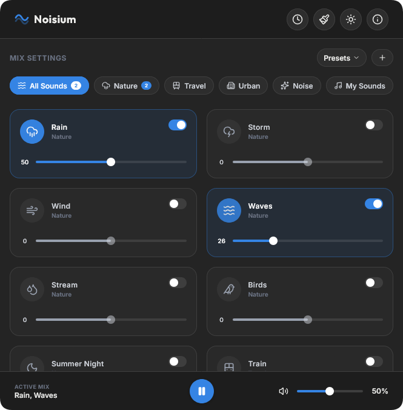

#  Noisium

**Create your own ambience**. Try it **[here](https://noisium.pages.dev)**.

<br>

<p align="center">
  
</p>

## Description

An ambient sound mixer designed to help you focus, relax, or block out distracting noise.

Web first, this is a Svelte rewrite and modernization of an old React project of mine, which itself was inspired by GNOME's **[Blanket](https://github.com/rafaelmardojai/blanket)**.

## Features

- Adjust individual volumes for all sounds
- Save your favorite configurations, or choose from a curated list.
- Import your own sounds.
- Sleep timer for automatic pausing.
- Private. All is kept on your local device.

## Installation

### Windows

Todo

## Build From Source

### Windows

Ensure you have the following installed on your system:

- **[Git](https://git-scm.com/)**
- **[Bun](https://bun.sh/)**
- **[Cargo (Rust)](https://rust-lang.org/tools/install/)**
- **[Microsoft Visual Studio C++ Build Tools](https://visualstudio.microsoft.com/visual-cpp-build-tools/)**

Open PowerShell and run the following commands:

```bash
git clone https://github.com/sebilune/noisium.git
cd noisium
bun install
bun run tauri:build
```

The compiled application binary will be located in the `src-tauri/target/release` directory.

## Technologies

<p align="left">
  <a href="https://github.com/sebilune">
    
  </a>
</p>

- **[Svelte:](https://svelte.dev/)** Component framework.
- **[TypeScript:](https://www.typescriptlang.org/)** Typed superset of JavaScript.
- **[Tauri:](https://tauri.app/)** Desktop web-app framework.
- **[Vite:](https://vite.dev/)** Build tool for modern web apps.
- **[Tailwind CSS:](https://tailwindcss.com/)** Utility CSS framework.
- **[Lucide Svelte:](https://lucide.dev/)** Icons library.
- **[Bun:](https://bun.sh/)** JavaScript runtime and package manager.

## Contributing

Please read [CONTRIBUTING.md](CONTRIBUTING.md) for details on Noisium's development guidelines.

## License

This project is licensed under the **Creative Commons Attribution-NonCommercial-NoDerivatives 4.0 International (CC BY-NC-ND 4.0)** License. See the [LICENSE.md](LICENSE.md) file for details.
